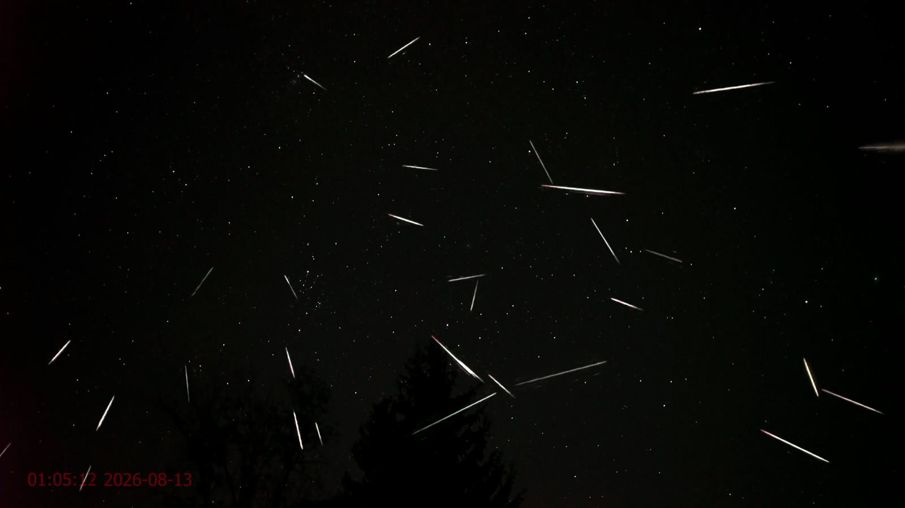
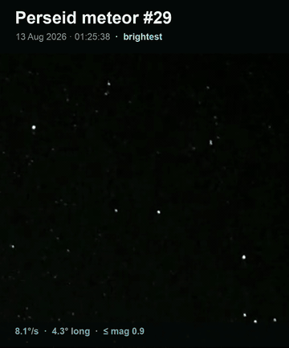
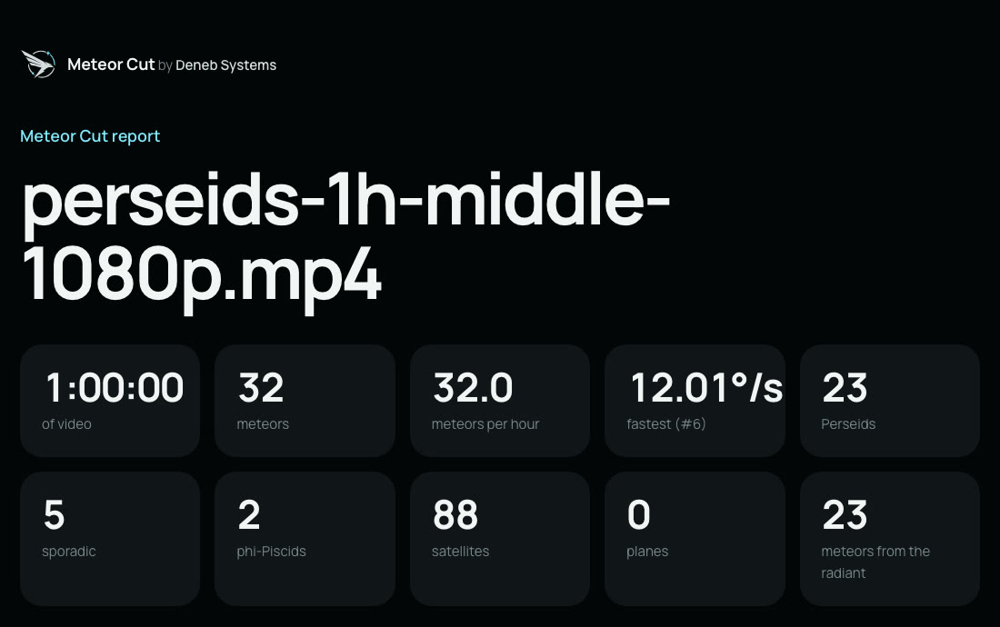
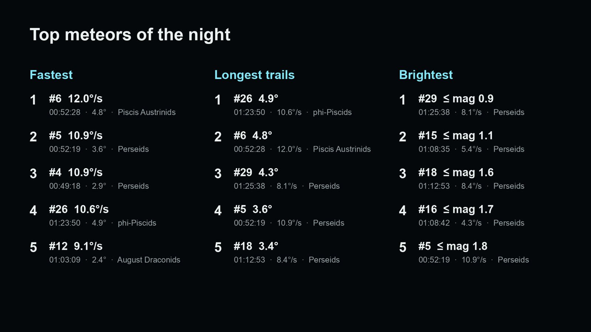
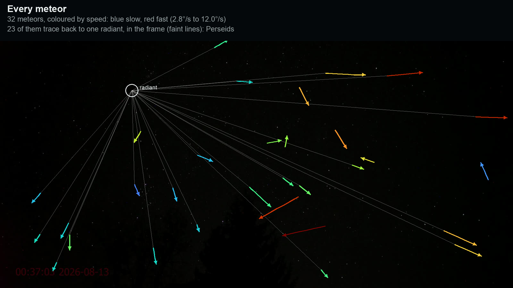

# Meteor Cut

[](https://github.com/Deneb-Systems/meteor-cut/actions/workflows/ci.yml)
[](https://pypi.org/project/meteor-cut/)
[](https://pypi.org/project/meteor-cut/)
[](LICENSE)

Point a camera at the night sky, record for an hour or a whole night, and give Meteor Cut the video. It finds every
meteor and cuts a highlight video of just those moments, with each meteor boxed, its trail drawn and its speed shown,
and a panel listing them all from fastest to slowest. It stacks every meteor of the night onto one starry picture, cuts
vertical clips of the best ones for Shorts and Reels, ranks the longest and brightest, picks out satellites and planes,
draws every trajectory with the shower's radiant, maps where meteors appeared, and writes it all to CSV. Given the time
(and, ideally, the stars), it names each meteor's shower and estimates its magnitude. It can also watch a camera live
and keep only the meteors.

Meteors are found and followed by [Sky Tracker](https://sky-tracker.deneb-systems.com)'s `MotionTracker`, which looks
for what got brighter since the previous frame: the head of a meteor rather than the trail it leaves.

<p align="center">
  
  <br><sub>Made by Meteor Cut from one hour of the Perseids livestream <a href="https://www.youtube.com/watch?v=liw0ssminyc">LIVE Perseids Meteor Shower, Skywatch #265</a> by Skywatchers, 12-13 August 2026. Footage © Skywatchers.</sub>
</p>

## Install

```bash
pip install meteor-cut
```

Meteor Cut needs Python 3.10 or later. It installs the [Sky Tracker SDK](https://sky-tracker.deneb-systems.com), whose
motion tracker it uses in the mode that is free: no licence key or sign-up needed.

## Quick start

```bash
meteor-cut night.mp4
meteor-cut night.mp4 --focal 14 --sensor full-frame --tilt 40 --show all
meteor-cut night.mp4 --start "2026-08-12 22:30" --site 50.45,30.52 --solve
meteor-cut watch 0 -o tonight            # a live camera; Ctrl+C to stop
```

Or start the upload page and use it from your browser. It runs on your computer; videos never leave it. Each video's
results are kept in a folder of their own under `~/Meteor Cut` (choose with `--results`), named after the video and
the time, so they stay after the server stops; the uploaded copy of the video is deleted once processed.

```bash
meteor-cut serve            # then open http://127.0.0.1:8765
```

From Python:

```python
from meteor_cut import Lens, process

result = process("night.mp4", "night-meteors", lens=Lens(focal_mm=14, tilt_deg=40))
for meteor in result.found.meteors:
    print(meteor.label, f"{meteor.start_s:.1f} s", f"{meteor.motion.angular_speed_deg_s:.1f} deg/s")
```

## What you get

Here is one hour of the 2026 Perseids, from the same livestream as the picture at the top: 32 meteors, 23 of them
from the Perseid radiant, and 88 satellites.

<table>
  <tr>
    <td width="34%" valign="top"></td>
    <td valign="top">
      
      
    </td>
  </tr>
  <tr>
    <td colspan="2"></td>
  </tr>
</table>

<sub>Made by Meteor Cut from one hour of the Perseids livestream <a href="https://www.youtube.com/watch?v=liw0ssminyc">LIVE Perseids Meteor Shower, Skywatch #265</a> by Skywatchers, 12-13 August 2026. Footage © Skywatchers.</sub>

Results go to `night-meteors/` beside the video (choose with `-o`):

| File | What is in it |
|---|---|
| `report.html` | Everything on one page to read or share: totals, meteors per hour, the pictures, sortable tables |
| `meteors.mp4` | The highlight video, 1920x1080, ending on the pictures below |
| `composite.png` | Every meteor of the night on one clean picture of the sky, lined up on the stars when they are identified |
| `top.png` | The five fastest meteors, the five longest trails and the five brightest |
| `shorts/` | Vertical 9:16 clips for Shorts and Reels, a folder per top list: `fastest/`, `longest/` and `brightest/` (`01-meteor-12.mp4` tops the list). Each is a close-up over the whole frame, then a quarter-speed replay |
| `trajectories.png` | Every meteor of the night, coloured by speed, and the radiant they trace back to |
| `satellites.png` | Every satellite and plane |
| `heatmap.png` | Where in the frame meteors appeared |
| `meteors.csv` | One row per meteor: time (and clock time), position, length, direction, speed, brightness and magnitude, shower, sky coordinates, and its ranks by speed, length and brightness |
| `satellites_planes.csv` | One row per satellite or plane |
| `meteor_points.csv` | Every tracked position of every object, frame by frame |
| `rejected.csv` | Everything that moved but was not kept, with the reason (people, lamps, too slow, ...) |
| `summary.json` | Totals, rates, the camera, the radiant, showers, fireballs, the top fives, versions and every setting used |
| `sky-frame.png` | With `--solve`: the clean star picture that was plate-solved |

## Speeds

| You give | You get |
|---|---|
| Nothing | Speed on screen, in pixels per second |
| The lens: `--focal` with `--sensor`, or `--fov` | Angular speed in degrees per second, which is what meteor observers compare |
| The lens and `--tilt` (degrees above the horizon) | Also an estimate in km/s |

One camera cannot see a meteor move towards or away from it, so the km/s figure is the speed across your view, at the
height meteors burn (95 km by default, `--altitude`): the real speed is at least that. Values well above 72 km/s, the
fastest a meteor can enter the atmosphere, mean the lens or tilt is wrong. The lens is assumed to be rectilinear (a
normal wide-angle lens, not a fisheye), and the video to show the sensor's full width.

## Time, place and stars

Three optional pieces of information make the results richer:

| You give | You get |
|---|---|
| `--start` (when the video started) | Clock times everywhere, and each meteor's shower when the stars are known |
| `--site LAT,LON` (where the camera stood) | Elevations and km/s without a tilt, and showers whose radiant was below the horizon left out |
| `--solve`, or `--wcs` | The camera's exact place among the stars: exact angular speeds despite lens distortion, the radiant in sky coordinates, each meteor's shower, magnitudes, and a composite lined up on the stars |

`--solve` identifies the stars with [astrometry.net](https://astrometry.net) on your computer: install it
(`brew install astrometry-net` on macOS, `apt install astrometry.net` on Debian and Ubuntu), then run
`meteor-cut star-index` once to fetch the five small index files a wide-angle camera needs (1.6 MB). Without
installing anything, run `meteor-cut sky-frame night.mp4`, upload the picture at
[nova.astrometry.net](https://nova.astrometry.net/upload), download `wcs.fits` from its result page and pass
`--wcs wcs.fits`. The camera must not move during the recording; in a compilation the solution holds for the scene
its frame came from.

Showers come from the IAU Meteor Data Center's list of established showers, and magnitudes from the stars of the Yale
Bright Star Catalogue in the same frames. Magnitudes from compressed video are rough (half a magnitude or so), and
one marked `≤` saturated the camera, so it was at least that bright. A meteor of magnitude -4 or brighter is a
fireball.

## Watching live

```bash
meteor-cut watch 0 -o tonight                      # the first camera or capture card
meteor-cut watch rtsp://camera.local/stream -o tonight --fov 90 --minutes 480
```

Live mode keeps the last few seconds in memory and saves a clip of each meteor (from just before it appeared) as soon
as the rules have confirmed it, about ten seconds after it ends: lamps and people are told apart by what else moves
near them. It writes `clips/`, `meteors.csv` as it goes, and `composite.png` and `summary.json` when it stops. A
video file works too, read as fast as the computer allows, as if it were live.

## Options worth knowing

| Option | Use it when |
|---|---|
| `--sky X,Y,W,H` | Trees, people or lights on the ground get in the way: look only at the sky |
| `--show meteors,satellites,planes` or `--show all` | You want satellites and planes in the video too (they are always in the tables) |
| `--min-speed F` | Slow meteors are missed (default 0.04 frame widths per second) |
| `--no-trails` | You prefer a clean picture without the paths of earlier meteors |
| `--no-video` | You only need the tables and pictures |
| `--shorts N` | You want more or fewer vertical clips: the top N of each list (default 5, 0 for none) |
| `--no-composite` | You do not need the composite picture |

`meteor-cut --help`, `meteor-cut process --help` and `meteor-cut watch --help` list everything.

## How it works

In short: Sky Tracker follows everything that moves, twice (every frame for meteors, about five frames a second for
satellites and planes). Meteor Cut then keeps what moves like a meteor: straight, fast, over in a few seconds, and
never twice in the same place. Lights that flare in one spot, people, and groups of things moving together are left
out, and scene cuts in compilations are handled. [docs/how-it-works.md](docs/how-it-works.md) explains each step and
its limits.

## Contributing

Bug reports with a sample video are the most useful thing you can send. See [CONTRIBUTING.md](CONTRIBUTING.md) to set
up a development copy; the tests run without a Sky Tracker licence.

## Licence

Meteor Cut is MIT-licensed: see [LICENSE](LICENSE). It uses the Sky Tracker SDK, which has its
[own licence](https://sky-tracker.deneb-systems.com/terms/). The bundled star catalogue (Yale Bright Star Catalogue, Hoffleit & Warren 1991) and meteor shower list (IAU Meteor Data
Center; Jenniskens et al. 2020, Jopek & Kanuchova 2017) are scientific reference data: see
[src/meteor_cut/data/README.md](src/meteor_cut/data/README.md). The upload page and report use the Manrope typeface,
included under the SIL Open Font License ([src/meteor_cut/web/static/fonts/Manrope-OFL.txt](src/meteor_cut/web/static/fonts/Manrope-OFL.txt)).
The Deneb Systems name and logo are trademarks of Deneb Systems and are not covered by the MIT licence: forks may
keep the logo where it credits the original project, but should not use it to brand their own.
